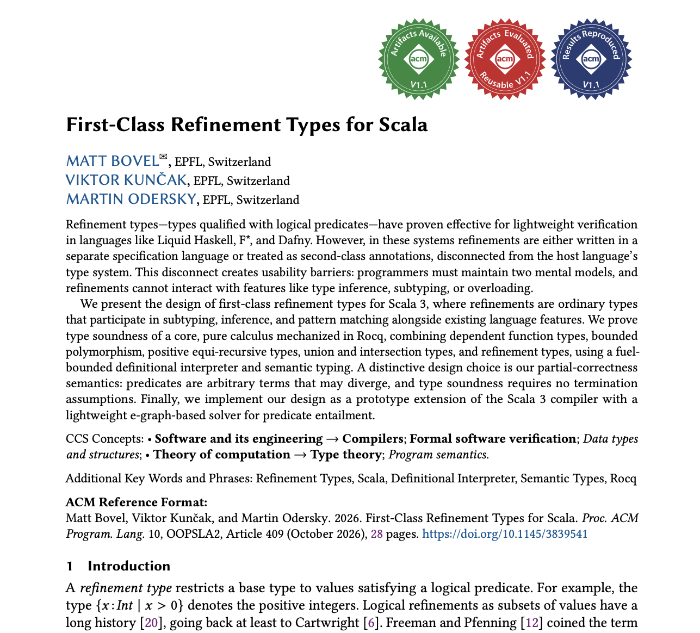

## What is this about?

A *prototype* implementation of (logical) refinement types for Scala.

<div class="fragment">

A _refinement type_ is a  type _refined_ with a logical predicate. For example:

```scala
type Pos = {x: Int with x >= 0}
```

</div>

## Syntax

Long form, whith an explicit binder:

```scala
type NonEmpty[A] = {l: List[A] with l.nonEmpty}
```

<div class="fragment">

Short form, reusing a name already in scope:

```scala
val x: (Int with x % 2 == 0) = 42
// desugars to:
val x: {v: Int with v % 2 == 0} = 42
```

</div>

<div class="fragment">

Surveyed and implemented by [Quentin Bernet](https://www.linkedin.com/in/quentin-bernet-983878152/) for his Master thesis.

</div>

## Example 1: Sized lists

```scala
def zip[A, B](
  xs: List[A],
  ys: List[B] with ys.size == xs.size
): {zs: List[(A, B)] with zs.size == xs.size}
```

```scala {.fragment}
def concat[T](
  xs: List[T],
  ys: List[T]
): {zs: List[T] with zs.size == xs.size + ys.size}
```

```scala {.fragment}
val xs: List[Int] = ???
val ys: List[Int] = ???
zip(concat(xs, ys), concat(ys, xs))
```

## whoami

<div class="columns">

<div class="column">


</div>

<div class="column">

<div class="fragment">

PhD student at EPFL, co-advised by:

- Martin Odersky (LAMP/Scala)
- Viktor Kunčak (LARA/Stainless)

</div>

</div>

</div>

## OOPSLA 2026 paper

<a href="https://doi.org/10.1145/3839541"></a>

## Refinement vs. Assertions

<div class="columns">
<div class="column">

Why not use assertions instead?

```scala
def zip[A, B](
  xs: List[A],
  ys: List[B]
) : List[(A, B)] = {
  require(xs.size == ys.size)
  ???
}.ensuring(_.size == xs.size)
```

<div class="fragment">

1. **Runtime overhead**: assertions are checked at runtime, refinement types are checked at compiletime (by default).

</div>

</div>
<div class="column">


<div class="fragment">

2. **No static guarantees**: assertions are only tested with the inputs you run them with. Refinements types hold _for all values_.

</div>

<div class="fragment">

3. **Not part of the API**: assertions are not visible in the function type / scaladoc.

</div>

<div class="fragment">

4. **Hard to compose**: assertions cannot be passed as type argument:

    ```scala
    type Pos = {x: Int with x >= 0}
    def foo(l: List[Pos])
    def bar(f: Pos => Pos)
    ```

</div>

</div> <!-- .column -->

</div> <!-- .columns -->


## Example 2: Fansi

<div class="columns">

<div class="column">

With assertions:

```scala


def True(r: Int, g: Int, b: Int) =
  True0(r, g, b, trueIndex(r, g, b))

def trueIndex(r: Int, g: Int, b: Int) =
  require(0 <= r && r < 256)
  require(0 <= g && g < 256)
  require(0 <= b && b < 256)
  r << 16 | g << 8 | b
```

</div>

<div class="column">

<div class="fragment">

With refinement types:

```scala
type Comp =
  {v: Int with 0 <= v && v < 256}

def True(r: Comp, g: Comp, b: Comp) =
  True0(r, g, b, trueIndex(r, g, b))

def trueIndex(r: Comp, g: Comp, b: Comp) =
  r << 16 | g << 8 | b


```

</div>

</div>

</div>

## _first-class_?

In our prototype, refinement tyes are ordinary Scala types, participating in inference, **overload resolution** (example 3), **subtyping** (example 4), etc.

<div class="fragment">

This is contrasting with other languages such as Liquid Haskell, where refinement types are implemented as a plugin that runs after type checking:

```haskell
{-@ x :: {v:Int | v mod 2 == 0 } @-}
let x = 42 :: Int in ...
```

</div>

<div class="fragment">

Our implementation is directly integrated into the Scala 3 compiler:

```scala
val x: (Int with x % 2 == 0) = 42
```

</div>

## Error messages

Predicates are type-checked like other Scala expressions:

```scala
def f[A](l: List[A] with l.notEmpty) = () // error
```

```text
-- [E008] Not Found Error: 6_error_messages.scala:9:27
9 |def f[A](l: List[A] with l.notEmpty) = () // error
  |                         ^^^^^^^^^^
  |      value notEmpty is not a member of List[A] - did you mean l.nonEmpty?
```

## Error messages and inference

Same inference and error reporting as for other Scala types:

```scala
type PosInt = {v: Int with v > 0}
def g[T](f: T => Unit, x: T) = f(x)
g((x: PosInt) => x * 2, -2) // error
```

```text
-- [E007] Type Mismatch Error: 6_error_messages.scala:17:26
17 |  g((x: PosInt) => x * 2, -2) // error
   |                          ^^
   |                          Found:    (-2 : Int)
   |                          Required: {x: Int with x > 0}
```

## Example 3: Overload resolution

```scala
def min(l: List[Int] with l.isSorted) =
  l.head // O(1)

def min(l: List[Int]) =
  l.min // O(n)

def ex1(l: List[Int] with l.isSorted) =
  min(l) // calls the first overload
```

## Example 4: Bounded polymorphism

<p style="margin-bottom: -1em"><small>Inspired by [Abstract Refinement Types](https://goto.ucsd.edu/~rjhala/liquid/abstract_refinement_types.pdf) (Vazou et al., ESOP 2013).</small></p>

```scala
given Ord[Int] = ...

type Even = {v: Int with v % 2 == 0}

def ex2: Even =
  maximum(List(2, 4, 6))
```

<div class="fragment">

```scala
def maximum[T: Ord, U <: T](xs: List[U]): U =
  xs.reduce(max)
```

</div>

## Refinement types vs. existings constructs

<div class="columns">
<div class="column">

<div class="column fragment">

Scala already have _structural refined types_:

```scala
def zip[A, B](
  as: List[A],
  bs: List[B] {
    val size: as.size.type
  }
): List[(A, B)] {
  val size: as.size.type
}
```

</div>

</div>

<div class="column">

<div class="fragment">

And singleton types, and opaque types, and compiletime operations:

```scala
opaque type SizedList[
  X <: Int: Singleton,
  A
] <: List[A]

def zip[A, B, Size <: Int: Singleton](
  as: SizedList[Size A],
  bs: SizedList[Size, B]
): SizedList[Size, (A, B)]
```

</div>

</div>

</div> <!-- .columns -->

## Refinement types vs. libraries

With [Iron](https://github.com/Iltotore/iron), predicates are defined as type-level constraints:

```scala
extension (l: List[Int]) def isSorted(): Boolean =
  l.zip(l.drop(1)).forall((x, y) => x <= y)

final class IsSorted
given Constraint[List[Int], IsSorted] with
  override inline def test(inline l: List[Int]): Boolean = l.isSorted()
  override inline def message: String = "List must be sorted"

def min(l: List[Int] :| IsSorted): Int = l.head
```

<div class="fragment">

```scala
min(List(1, 2, 3))              // ⛔️ cannot be verified at compile time
min(List(1, 2, 3).refineUnsafe) // ✅ checked at run time
```

</div>

## Limitations of existing approaches

Existing constructs (structural refinements, singleton types, compile-time operations) and libraries (Iron) suffer from:

<div class="fragment">

- _Limited reasoning_: only fields, literals, constant folding, etc.

</div>

<div class="fragment">

- _Not inferred_: types must be annotated manually, or programs are not typable at all.

</div>

<div class="fragment">

- _Different languages_: predicates are written at the type level (`IsSorted`, `as.size.type`), not at the term level (`isSorted`, `as.size`).

</div>

## What are valid predicates?

<div class="fragment">

```scala
var x = 3
val y: Int with y == 3 = x // ⛔️ x is mutable
```

</div>

<div class="fragment">

```scala
class Box(val value: Int)
val b: Box with b == Box(3) = Box(3) // ⛔️ Box has equality by reference
```

</div>

<div class="fragment">

The predicate language is restricted to a fragment of Scala consisting of constants, stable identifiers, field selections over `val` fields, pure term applications, type applications, and constructors of case classes without initializers.

</div>

<div class="fragment">

Purity of functions is currently not enforced. Should it be?

</div>

## Mixed-precision type inference

<div class="columns">

<div class="column">

Refinement types are **not** inferred from terms by default; the wider type is:

```scala
val x = 42
// x: Int, not {v: Int with v == 42}
```

<div class="fragment" data-fragment-index="1">

Why not always infer the precise type?

1. **Backward compatibility:** implicit and overload resolution depend on inferred types; a more precise type changes which instances are found.

</div>

</div>

<div class="column">

<div class="fragment" data-fragment-index="1">

2. **Performance:** bigger types, slower comparisons.
3. **Developer eXperience:** users would be flooded with complex types.

</div>

<div class="fragment" data-fragment-index="2">

Instead, precision is recovered **on demand**, by a standard mechanism called _selfification_, triggered by the bidirectional type-inference algorithm:

```scala
val x: (Int with x == 42) = 42
```

</div>

</div>

</div>


## Solver

<div class="columns">

<div class="column">

How does the compiler check `{x: T with p(x)} <: {x: T with q(x)}`?


<div class="fragment">

Need to check that `p(x)` implies `q(x)` for all `x: T`.

</div>

<div class="fragment">

Existing implementations in other languages lower to SMT solvers.

</div>

<div class="fragment">

Due to packaging and performance concerns, we instead implemented our own **lightweight e-graph-based solver**.

</div>

</div>

<div class="column">

<div class="fragment">

```scala
{v: Int with v == a && a == b}
  <: {v: Int with v == b}
{v: Int with a == b}
  <: {v: Int with f(a) == f(b)}
```

</div>

<div class="fragment">

And domain-specific normalizations such as:

```scala
{v: Int with v == x + 3 * y}
  <: {v: Int with v == 2 * y + (x + y)}
```

Also beta-reduction, ADT selections reductions and limited reasoning on LIA inequalities.
</div>

</div>

</div>

<div class="notes">

- Strictly stronger than substitution alone; intentionally weaker than equality saturation: one representative per class, so only one form is explored.

</div>

## Subtyping: Constant folding

```scala
{v: Int with v == 1 + 1}     <: {v: Int with v == 2}
```

## Subtyping: Normalization

Arithmetic expressions are normalized using standard algebraic properties, for example commutativity of addition:

```scala
{v: Int with v == x + 1}     <: {v: Int with v == 1 + x}
```

<div class="fragment">

```scala
{v: Int with v == y + x}     <: {v: Int with v == x + y}
```

</div>

<div class="fragment">

Or grouping operands with the same constant factor in sums of products:

```scala
{v: Int with v == x + 3 * y} <: {v: Int with v == 2 * y + (x + y)}
```

</div>

## Subtyping: Local unfolding

As mentioned, refinement types are not inferred from terms by default. However, the solver can unfold definitions of local `val` (only), even when they have an imprecise type:

```scala
val x: Int = ...
val y: Int = x + 1

{v: Int with v == y} =:= {v: Int with v == x + 1}
```

## Subtyping: Equality reasoning

Transitivity of equality:

```scala
{v: Int with v == a && a == b} <: {v: Int with v == b}
```

<div class="fragment">

Congruence of equality:

```scala
{v: Int with a == b}           <: {v: Int with f(a) == f(b)}
```

</div>

<div class="fragment">

This is implemented using an E-Graph-like data structure.

</div>

## Subtyping: With other Scala types

Literal types are subtypes of singleton refinement types:

```scala
3 <: {v: Int with v == 3}
```

<div class="fragment">

We plan to support subtyping with other Scala types in the future.

</div>

## Run-time checks

**Pattern matching** branches on whether the predicate holds at run time:

```scala
val idRegex = "[0-9a-f]{4}-[0-9a-f]{4}"
type ID = {s: String with s.matches(idRegex)}

"a2e7-e89b" match
  case id: ID => ... // holds, id has type ID
  case _      => ... // does not hold
```

## Run-time checks: `.runtimeChecked`

You can also use `.runtimeChecked` ([SIP-57](https://docs.scala-lang.org/sips/replace-nonsensical-unchecked-annotation.html)) when you expect the check to always pass:

```scala
val id: ID = "a2e7-e89b".runtimeChecked
```

<div class="fragment">

Desugars to:

```scala
val id: ID =
  if ("a2e7-e89b".matches(idRegex)) "a2e7-e89b".asInstanceOf[ID]
  else throw new IllegalArgumentException()
```

</div>

<div class="fragment" style="font-size: 0.8em;">

Note: like with other types, you can also use `.asInstanceOf[ID]` directly to skip the check altogether.

</div>

<div class="fragment">

`.runtimeChecked` for refinement types was implemented by Valentin Schneeberger.

</div>

## Gradual typing

By default, a refinement that cannot be verified statically is a type error:

```scala
def getInt(): Int = 1
val x: {v: Int with v == 1} = getInt() // ⛔️ type error
```

<div class="fragment">

A language import turns these errors into something else:

```scala
import language.experimental.qualifiedTypes.runtimeChecks // or warn, or silent
```

| Mode | Unverified refinement becomes |
|---|---|
| `runtimeChecks` | run-time check, throws if it fails |
| `warn` | warning, no run-time check |
| `silent` | accepted, no run-time check |

</div>

## Example 5: Memoized Fibonacci

A map whose values are related to their keys by a predicate `p`:

```scala
case class DepMap[K, V](p: (K, V) => Boolean):
  def put(n: K, v: V with p(n, v)): Unit = ???
  def get(n: K): Option[{res: V with p(n, res)}] = ???
```

<div class="fragment">

A function whose result type is its own definition:

```scala
def fib(n: Int): {r: Int with r == (if n <= 1 then 1 else fib(n - 1) + fib(n - 2))} =
  if n <= 1 then 1 else fib(n - 1) + fib(n - 2)
```

</div>

## Example 5: Memoized Fibonacci (2)

A memoized version, checked to always return `fib(n)`:

```scala
val cache: (DepMap[Int, Int] with (cache == DepMap[Int, Int]((k, v) => v == fib(k)))) =
  DepMap[Int, Int]((k, v) => v == fib(k))

def fibMemo(n: Int): {res: Int with res == fib(n)} =
  cache.get(n) match
    case Some(res) => res
    case None =>
      val res: (Int with (res == fib(n))) =
        if n <= 1 then 1 else fibMemo(n - 1) + fibMemo(n - 2)
      cache.put(n, res)
      res
```

## Evaluation

<div class="columns">

<div class="column">

**Compilation overhead**, against each system's own unchecked baseline:

| System | Overhead |
|---|---|
| First-class (ours) | **0–13%** |
| Schmid and Kunčak | 20–41% |
| Stainless | ≥ 53% |

<div class="fragment">

**When the feature is unused**, the full Dotty CI passes unchanged: the compiler itself (≈200 000 LoC),<br/>≈10 000 tests, a 50-project community build.

≤ 4% slowdown on the official benchmark suite.

</div>


</div>

<div class="column">


</div>

</div>

## Future work

<div class="columns">

<div class="column">

Implementation:

- **Better Solver** for what our lightweight solver cannot do.

- **A termination checker**, needed only for the termination-sensitive entailment rules, never systematically for every function in a predicate.

- **Term-parameterized types**, to modularize predicates:

```scala
    type Range(from: Int, to: Int) =
      {v: Int with v >= from && v < to}
```

</div>

<div class="column">

Theory:

- **Rules for semantic implication.** We leave implication purely semantic; the solver's normalization rules are not yet verified against it.

- **Enforcing purity.** Today a function called in a predicate is *assumed* pure. Capture and separation checking can ensure that predicates are pure.

- **Classes and objects**, absent from the presented core calculus.

</div>

</div>

## How to use

Try it online in the [playground](https://matt.bovel.net/scala-refinement-types/playground/).

<div class="fragment">

**[Scala CLI](https://scala-cli.virtuslab.org/):** add these directives and run `scala --cli-version 1.18.0 run hello.scala`:

```scala
//> using scalaOrganization ch.epfl.lara
//> using scala 3.10.1-RC1-bin-20260903-e1f9361-NIGHTLY
//> using options -language:experimental.qualifiedTypes
```

</div>

<div class="fragment">

**[sbt](https://www.scala-sbt.org/):** in `build.sbt`:

```scala
scalaOrganization := "ch.epfl.lara"
scalaVersion := "3.10.1-RC1-bin-20260903-e1f9361-NIGHTLY"
scalacOptions += "-language:experimental.qualifiedTypes"
```

</div>

## Conclusion

<div class="columns">

<div class="column" style="flex: 1.5;">

We showed:

1. A **prototype implementation** of refinement types in Scala 3 as _first-class_ types; normal Scala types that participate in subtyping, inference, overloads resolution and pattern matching.

2. A core **calculus** proven sound in Rocq by semantic typing. It includes refinements, dependent functions and pairs, sums, unions, intersections and equi-recursive positive types, and allows predicates to diverge.

</div>

<div class="column" style="margin-left: 1.2em;">

Slides and paper:

<div style="width: 100%;">

<small><a href="https://matt.bovel.net/scala-refinement-types/">matt.bovel.net/scala-refinement-types/</a></small>
</div>

</div>

<div class="column" style="flex: 0 0 auto;">

<figure style="text-align: center; margin: -1.2em 0 0 0;">

<figcaption><small><em>Un type raffiné</em>,<br/>by Marina Granados Castro</small></figcaption>
</figure>

</div>

</div>

# Bonus slides

## Backup: LH Usability Barriers

From [“Usability Barriers for Liquid Types”](https://dl.acm.org/doi/10.1145/3729327) [1]:

- 4.2 Unclear Divide between Haskell and LiquidHaskell:
  - <small>“comments are usually seen as just optional information in the code and not something that is directly used by the compiler”</small>
  - <small>“It's sort of like you're doing two things at once because you're implementing in Haskell. But you're also talking to GHC, but you're also talking to LiquidHaskell.”</small>
- 4.7 Unhelpful Error Messages
  - <small>“[...] error messages produced from typing errors inside the predicates, seemed indistinguishable from those produced by verification errors.”</small>
- 4.8 Limited IDE Support 
  - <small>“[user] tried to use the function <code>length</code>, but since it was not imported, it was impossible to use in this case.”</small>

<small>[1] Catarina Gamboa, Abigail Reese, Alcides Fonseca, and Jonathan Aldrich. 2025. Usability Barriers for Liquid Types. Proc. ACM Program. Lang. 9, PLDI, Article 224 (June 2025), 26 pages. <a href="https://dl.acm.org/doi/10.1145/3729327">doi:10.1145/3729327</a></small>


## Backup: `List.collect`

Scala type parameters are _erased_ at runtime, so we cannot match on a `List[T]`.

<div class="fragment">

However, we can use `.collect` to filter and convert a list:

```scala
type Pos = { v: Int with v >= 0 }

val xs = List(-1,2,-2,1)
xs.collect { case x: Pos => x } : List[Pos]
```

</div>


## Backup: Value interpretation (more)

<div class="fragment">

Value interpretation of **function types**:

$$
\begin{aligned}
\mathcal{V}\llbracket \Pi x{:}A.\, B \rrbracket_{\delta}^{\rho}(v) \triangleq\ & \exists \rho_f, b.\; v = \langle \rho_f, \lambda x.\, b \rangle\ \land \\
  & \forall v_a.\; \mathcal{V}\llbracket A \rrbracket_{\delta}^{\rho}(v_a) \implies \mathcal{E}\llbracket B \rrbracket_{\delta}^{\rho_f[x \mapsto v_a]}(b)
\end{aligned}
$$

</div>


<div class="fragment">

Value interpretation of **recursive types**?

$$\textcolor{red}{\mathcal{V}\llbracket \mu X.\, A \rrbracket_{\delta}^{\rho}(v) \triangleq \mathcal{V}\llbracket A \rrbracket_{\delta[X \mapsto \mathcal{V}\llbracket \mu X.\, A \rrbracket_{\delta}^{\rho}]}^{\rho}(v)}$$

</div>

<div class="fragment">

$$\mathcal{V}\llbracket \mu X.\, A \rrbracket_{\delta}^{\rho}(v) \triangleq \forall n.\; F^n(v)$$

$$F^0(v) = \top,\quad F^{n+1}(v) = \mathcal{V}\llbracket A \rrbracket_{\delta[X \mapsto F^n]}^{\rho}(v)$$

</div>
